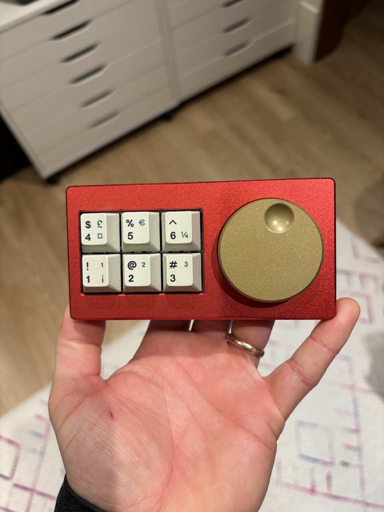
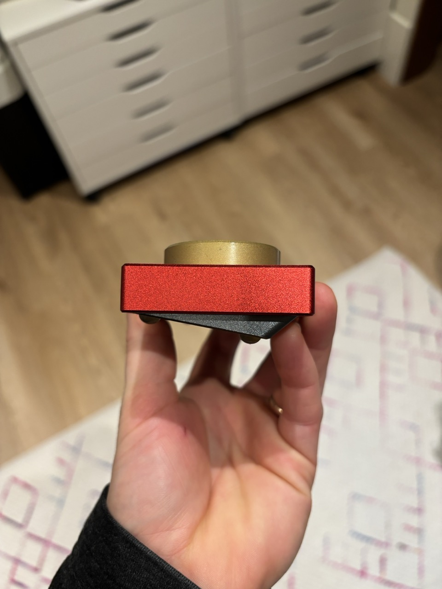
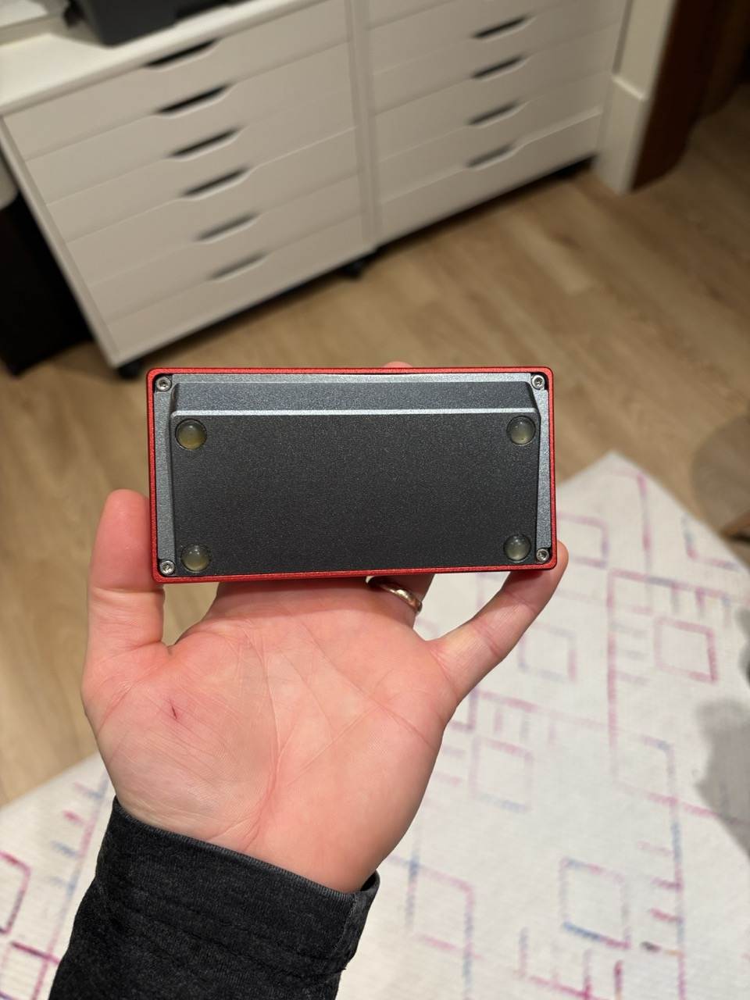
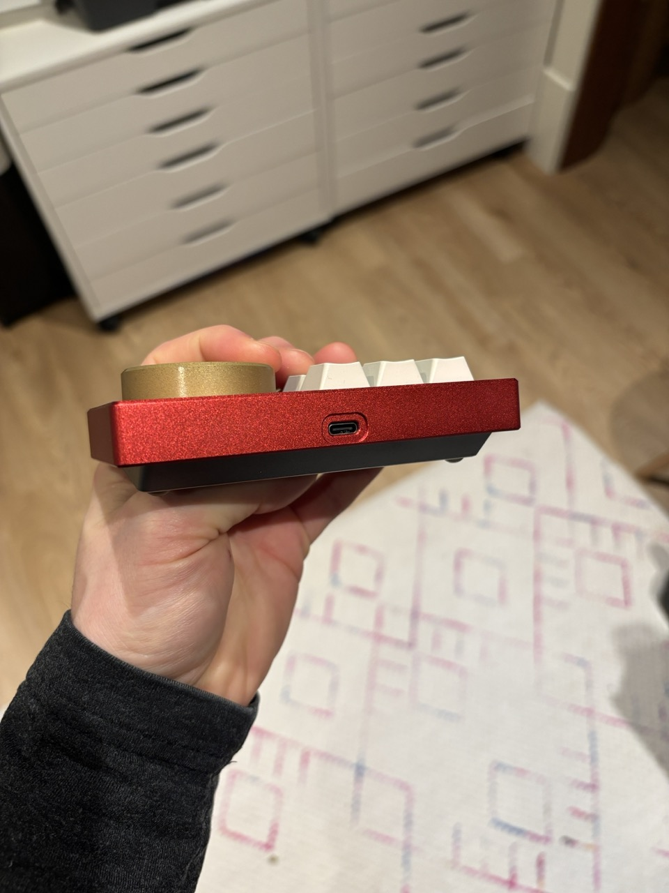
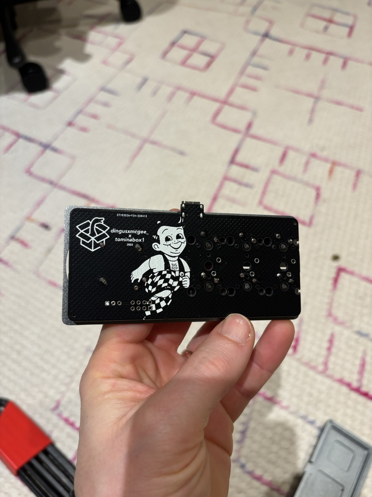
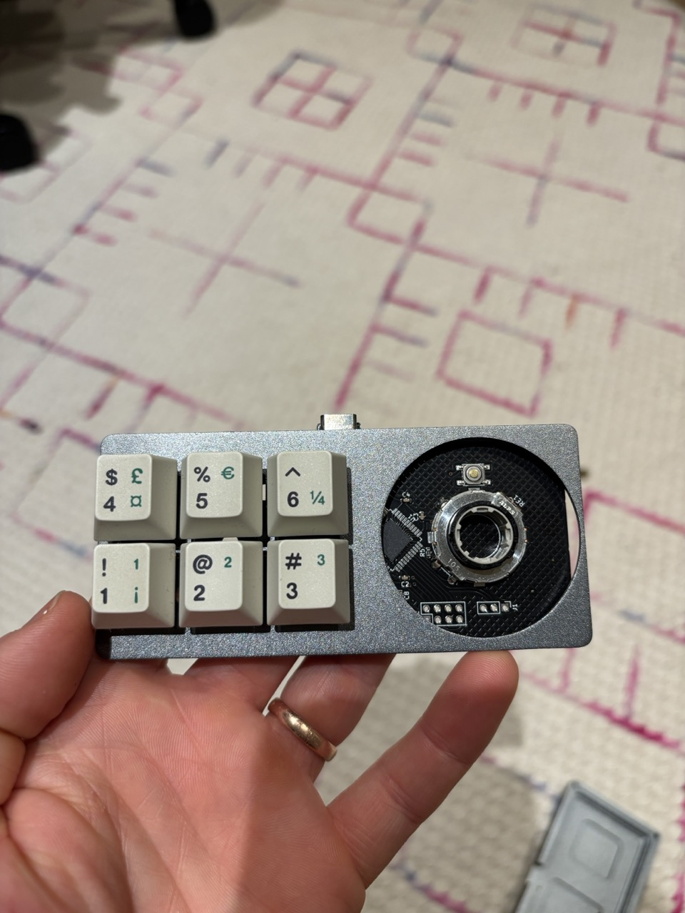

# BigBoy
 BigBoy is a 6 key macropad with a rotary encoder and a big ol brass knob. The case and its parts were designed by me and the pcb was designed by tominabox.

Encoder used (EC21A1540401):
https://www.mouser.com/en/ProductDetail/Alps-Alpine/EC21A1540401?qs=YMSFtX0bdJDqJ3PNi4kFEA%3D%3D

Screws:

Case: m2.5 sockethead 5mm 
https://www.mcmaster.com/91292A009/

Bumpons: 8x2.5
https://www.amazon.com/Silicone-Rubber-Bumpons-Adhesive-Circles/dp/B07DN6W6VN/ref=sr_1_5?crid=3ADHACEENERSY&keywords=8mm%2Bbumpons&qid=1651329537&sprefix=8mm%2Bbumpon%2Caps%2C150&sr=8-5&th=1

Many thanks to tominabox for the pcb work and collaboration on this project!

*All files are provided as is and I accept no liability if they aren't very good.*

*These files were specifically designed to be milled by a CNC machine. Any other fabrication method may require modification*

*Licensed with Unlicense*

If you would like to support me in some way, consider [buying me a coffee :)](https://www.buymeacoffee.com/dingusxmcgee)